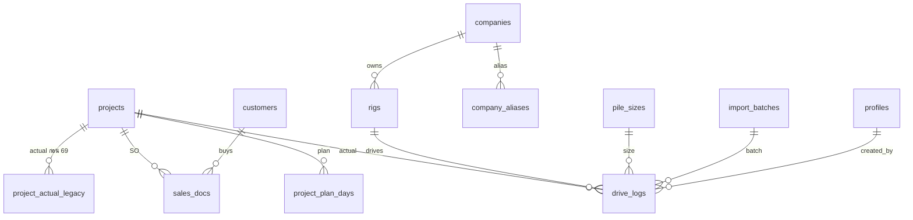

# Data Model (ร่าง) — Supabase / Postgres

> ร่างแรกเพื่อวางแผน รายละเอียดคอลัมน์จะยืนยันอีกครั้งใน Phase 1 ก่อนเขียน migration

## ตารางหลัก

| ตาราง | ที่มา | คอลัมน์สำคัญ |
|---|---|---|
| `profiles` | Supabase Auth | id → auth.users, full_name, role (`admin` `planning` `manager` `accounting` `drive_team`), active |
| `projects` | Pile A–Q (+ คิว-วัน/SO สำหรับโครงการที่ไม่มีใน Pile) | code PK (`A69-A101`), customer_name, project_name, agency, province, project_type, pm, sales, status (`ongoing` `on_hand` `hold` `completed` `cancelled`), order_qty, contract_value, value_per_pile, start_date, end_date, billing_cycle (Pile คอลัมน์ E แถว Actual), note |
| `project_plan_days` | Pile แถว Plan (wide → long) | project_code, plan_date, planned_qty — PK (project_code, plan_date) |
| `project_actual_legacy` | Pile แถว Actual ก่อนปี 2569 | project_code, work_date, qty (ใช้เฉพาะช่วงที่ไม่มีใน drive_logs) |
| `drive_logs` | คิว-วัน / กรอกในเว็บ / import | work_date, project_code, leader, rig_id, company_id, standard, pile_size_code, section, length_m, shift (A/B), qty, cubic_m, meters, note, source (`seed` `import` `manual`), import_batch_id, created_by, dedupe_key UNIQUE |
| `pile_sizes` | คิว-วัน แท็บ `ขนาด` | section (หน้าตัด) PK, type (IP/LP/SS…), size, variant, code (`IP18B`), m3_per_m |
| `rigs` | คิว-วัน (ชื่อปั้นจั่น) | id, name, rig_type (สามขา, รถตอก, โครง, รถกด, ระบบกด, รถแบ็คโฮ), company_id, active |
| `companies` / `company_aliases` | คิว-วัน (บริษัท) | companies: id, name, is_internal (ASIA); aliases: raw_name → company_id |
| `customers` | dataรวม | code PK (`ก0000182`), name, group (normalize ไทย/อังกฤษ), registered_at, is_new |
| `sales_docs` | dataรวม | doc_type (P/R/C), doc_date, so_code, project_code, customer_code, item_code, item_name, product, group_product, section, length, qty, unit_price, install_fee, amount, m3, approval_status, work_status, salesperson, service_type, construction_type, province |
| `import_batches` | ระบบ | id, kind (`drive_logs` `master_planning` `sales`), file_name, storage_path, uploaded_by, rows_added, rows_duplicate, rows_error, created_at, undone_at |
| `settings` | ระบบ | key, value — เช่น `runway_weeks = 8`, `rate_window_days = 28` |
| `billing_periods` [ต่อ] | ระบบ | period, locked_at, locked_by |
| `audit_log` [ต่อ] | ระบบ | table, row_id, changed_by, before, after, at |

`dedupe_key` = work_date | project_code | rig | section | length | shift | qty (ข้อเสีย: ถ้าวันเดียวกันมี 2 แถวเหมือนกันจริงจะนับเป็นซ้ำ → แสดงเตือนให้ผู้ใช้ยืนยัน)

## View

| view | ใช้ที่ | คำนวณ |
|---|---|---|
| `v_project_actual_days` | ทุกที่ | รวม drive_logs + project_actual_legacy ต่อโครงการต่อวัน (ไม่นับซ้ำ) |
| `v_project_so_net` | ทุกที่ | จำนวนสุทธิ (ต้น) และมูลค่าสุทธิ จากใบ P+R+C ต่อโครงการ (ตัดรายการบริการ) → ตรวจเทียบกับ `projects.order_qty` (Master Planning = ตัวจริง); ใช้เป็นยอดสั่งซื้อเฉพาะโครงการที่ไม่มีใน Master Planning |
| `v_project_progress` | M1, M2, M3 | ตอกแล้ว, คงเหลือ, แผนสะสมถึงวันล่าสุด, Ahead/Behind, อัตรา 28 วัน, วันคาดว่าเสร็จ, มูลค่าผลงาน |
| `v_backlog` | M4 | Σ คงเหลือ ต้น/บาท แยกสถานะ, อัตราตอก/สัปดาห์, runway_weeks, ระดับสี |
| `v_rig_schedule` | M6 | ปั้นจั่น × วัน × โครงการ × แผน (อิงปั้นจั่นล่าสุดที่ทำงานในโครงการ) |
| `v_sales_monthly` | M3, M4 | ยอดขาย P/R/C และสุทธิ ต่อเดือน × เซลล์ × กลุ่มลูกค้า |
| `v_billing_due` | M3 | มูลค่าผลงานงวดปัจจุบันตาม billing_cycle |

ทุก view ตั้ง `security_invoker = true`

## สิทธิ์ (RLS)

| ตาราง | admin | planning | manager | accounting | drive_team |
|---|---|---|---|---|---|
| projects | CRUD | CRUD | R | R | R |
| project_plan_days | CRUD | CRUD | R | R | R |
| drive_logs | CRUD | CRUD | R | R | R |
| sales_docs, customers | CRUD | R | R | R | – |
| master data (pile_sizes, rigs, companies) | CRUD | CRUD | R | R | R |
| import_batches | CRUD | CRUD | – | – | – |
| settings | CRUD | R | R | R | – |
| profiles | CRUD | อ่านของตัวเอง | อ่านของตัวเอง | อ่านของตัวเอง | อ่านของตัวเอง |

role อ่านผ่าน `public.my_role()` (security definer) จาก `profiles`

## Index ที่ควรมี
- `drive_logs (project_code, work_date)`, `drive_logs (work_date)`, `drive_logs (rig_id, work_date)`
- `project_plan_days (plan_date)`
- `sales_docs (doc_date)`, `sales_docs (project_code)`, `sales_docs (salesperson, doc_date)`

## ER (ย่อ)

